# Plan Maestro: Reingeniería del Catálogo QR de Calle, Blindaje Web y Asistente IA

> **Fecha:** 30 de Octubre de 2026  
> **Objetivo:** Separar taxativamente el Catálogo Web del Cliente del Catálogo QR de Calle, rediseñar el catálogo impreso para formato dúplex anillado con códigos QR de alto contraste, e implementar un flujo honesto y guiado con IA (Gemini) para resolver el 80% de productos sin fotografía sin falsos positivos ni alucinaciones.

---

## 1. Viabilidad y Diagnóstico de la Falla Anterior

> [!IMPORTANT]
> **Sí, es 100% posible y viable resolver todo el requerimiento.**
> Los errores anteriores donde el sistema traía fotos de caricaturas (*Winnie Pooh, Peppa Pig*) o ilustraciones médicas (*anatomía*) ocurrieron por tres fallas técnicas en `functions/api/search-images.js`:
> 1. **Búsqueda cruda sin anclaje de dominio:** Al buscar cadenas como `"SOBRE 11X15"` o `"CARPETA AMARILLA"`, Google y DuckDuckGo indexan títulos infantiles (*"Winnie Pooh y el sobre mágico"*) o académicos (*"Sobre la anatomía humana"*).
> 2. **Cero evaluación semántica de la imagen:** No había una capa intermedia de IA que validara si la imagen encontrada correspondía a un producto de papelería/oficina en packshot comercial antes de mostrarla.
> 3. **Ausencia de diálogo y honestidad:** El algoritmo forzaba un resultado a ciegas en lugar de admitir que una descripción abreviada de MixNet (ej. `ART MAN 100`) no era concluyente.

---

## 2. Mapa de Arquitectura: Dos Catálogos, Dos Propósitos

```mermaid
flowchart TD
    subgraph Cliente["1. Canal Cliente (Web / Digital)"]
        A[Campaña Email / WhatsApp] -->|Enlace con ?ref=CODVEN| B[catalogo.html]
        B --> C[Gaveta de Cotización quote-drawer]
        C -->|Envío directo simplificado| D[WhatsApp del Asesor + jjp_quotes]
        B -.->|BLOQUEADO / ERRADICADO| E[catalogo_impreso.html]
    end

    subgraph Calle["2. Canal Vendedor (Venta de Calle / Impreso)"]
        F[vendedor / admin] --> G[catalogo_impreso.html]
        G -->|Maquetación Dúplex Carta| H[Impresión Frente y Reverso]
        H -->|Margen de 25mm alternado| I[Cuaderno Anillado Físico]
        I -->|Cliente escanea QR grande 32mm| J[Ficha del Producto con ref de Vendedor]
    end

    subgraph IA["3. Estudio de Fotografía con IA Honesta"]
        K[Producto sin foto 80%] --> L[Gemini Copiloto Comercial]
        L -->|Evaluación de confianza| M{¿Confianza >= 90%?}
        M -->|Sí| N[Búsqueda Packshot Fondo Blanco]
        M -->|No / Ambigua| O[Pregunta honesta al Vendedor]
        O -->|Vendedor aclara en 1 clic| N
        N --> P[Guardado WebP en VPS jjp_products]
    end
```

---

## 3. Fase 1: Blindaje Total y Desacople del Catálogo Web

El cliente final **nunca** debe ver el catálogo impreso ni links técnicos hacia `catalogo_impreso.html`.

### Acciones Concretas:
1. **Purga en Barra de Navegación Pública (`assets/js/nav.js`):**
   - Eliminar el botón `{ label: '🖨️ Catálogo con QR', href: '/catalogo_impreso' }` del menú público.
2. **Purga en Editor de Campañas (`assets/js/vendedor/campaign-editor.js`):**
   - Eliminar cualquier fragmento o plantilla que inserte `https://jjpaper.pages.dev/catalogo_impreso`. La única URL permitida para el cliente es `https://jjpaper.pages.dev/catalogo.html?ref={CODVEN}`.
3. **Purga en Motor de Documentos (`assets/js/doc-engine.js`):**
   - Retirar del pie de página de cotizaciones la leyenda técnica `Pedidos WhatsApp / Catálogo con QR en jj-paper.pages.dev/catalogo_impreso.html`.
4. **Acceso Exclusivo Interno:**
   - Mantener el acceso a `catalogo_impreso.html` únicamente en el menú lateral administrativo y del vendedor (`admin/sidenav.js`).

---

## 4. Fase 2: Rediseño Técnico del Catálogo QR para Venta de Calle

El catálogo físico debe ser una herramienta de venta agresiva y rápida ("mira este producto, vale tanto, escanea aquí y te lo despacho").

### 4.1. Calibración para Impresión Dúplex y Anillado (Tipo Cuaderno)

Para que el espiral o anillado no perfore texto, fotos ni códigos QR:

| Parámetro | Página Impar (Frente) | Página Par (Reverso) | Justificación Técnica |
| :--- | :--- | :--- | :--- |
| **Margen de Lomo (Espiral)** | **Izquierda: 24 mm** | **Derecha: 24 mm** | Espacio libre sagrado para la máquina perforadora / anillado doble O. |
| **Margen Exterior** | Derecha: 8 mm | Izquierda: 8 mm | Aprovechamiento máximo del papel tamaño Carta (US Letter). |
| **Margen Superior / Inferior** | 7 mm / 7 mm | 7 mm / 7 mm | Centrado vertical exacto para calce a contraluz. |
| **Cuadrícula Par Obligatoria** | Hoja `N` (Frente) | Hoja `N` (Reverso) | Si el contenido termina en página impar, se genera automáticamente una página de *Notas de Visita y Toma de Pedidos* para que toda hoja física sea reversible. |

### 4.2. Reingeniería del Código QR de Alto Contraste

| Característica | Implementación Anterior (Falla) | Nueva Implementación (Optimizada) |
| :--- | :--- | :--- |
| **Dimensiones** | 64px a 112px (~16mm a 24mm) | **Mínimo 32mm × 32mm** (128px a 140px renderizado nítido en SVG/Canvas). |
| **Corrección de Errores** | Nivel `L` (7% de daño soportado) | **Nivel `M` o `Q` (15% a 25% de recuperación)**: permite escanear aunque el papel sufra dobleces, polvo o manchas leves. |
| **Marco y Contraste** | Caja genérica gris | **Recuadro de alto contraste con zona muda (*Quiet Zone*) de 4 módulos**: borde oscuro sólido y fondo blanco 100% puro para escaneo instantáneo bajo luz solar o bombillos tenues. |
| **Compatibilidad B/N** | Diseñado asumiendo color | **100% monocromático-friendly**: contrastes absolutos que no se empastan con fotocopia ni tóner gastado. |
| **Destino del QR** | Búsqueda genérica en catálogo web | **Enlace directo a ficha/pedido con atribución de vendedor**: `https://jjpaper.pages.dev/producto.html?sku={SKU}&ref={CODVEN}`. Al escanear, el cliente ve la foto, precio del día y el botón de pedir directo al WhatsApp del vendedor que le mostró el cuaderno. |

### 4.3. Estructura de Tarjeta de Producto de Calle

Cada tarjeta de producto en el catálogo impreso contendrá:
1. **Fotografía en recuadro cuadrado** (o packshot estándar con marca de agua sutil de JJ Paper si no tiene foto).
2. **Nombre comercial limpio y destacado** (eliminando ruido interno de códigos Clipper).
3. **Precio de Mostrador en USD ($)** en tipografía pesada y visible a distancia.
4. **Referencia de Tasa BCV**: Selector en barra superior para imprimir en solo USD o USD + Bs BCV.
5. **Empaque y Unidad mínima de despacho** (Bulto, Caja, Resma, Paquete, Docena).
6. **QR Gigante "Escanear para Pedir"**.

---

## 5. Fase 3: Flujo Inteligente de Fotografías con IA Honesta (Gemini)

Para enriquecer el 80% de productos sin fotografía sin perder horas buscando en Google manualmente ni arriesgar imágenes incoherentes:

### Reglas Inviolables del Asistente de Fotos:
1. **Honestidad Algorítmica Obligatoria:** Si la IA tiene una certeza menor al 90%, **debe detenerse y preguntar**. Prefiere decir *"No reconozco este código técnico; indícame marca o tipo"* antes que sugerir una imagen disparatada.
2. **Filtro Negativo B2B Estricto:** La búsqueda comercial bloquea de raíz términos de juguetes, caricaturas, ropa, calzado, anatomía, medicina, turismo y paisajes.
3. **Optimización Automática:** Toda foto seleccionada pasa por compresión WebP en el navegador y se sube directamente al CDN soberano del VPS (`/var/www/jjp-media/jjp-products/`), actualizando tanto la base de datos PostgreSQL como las vistas del catálogo.
