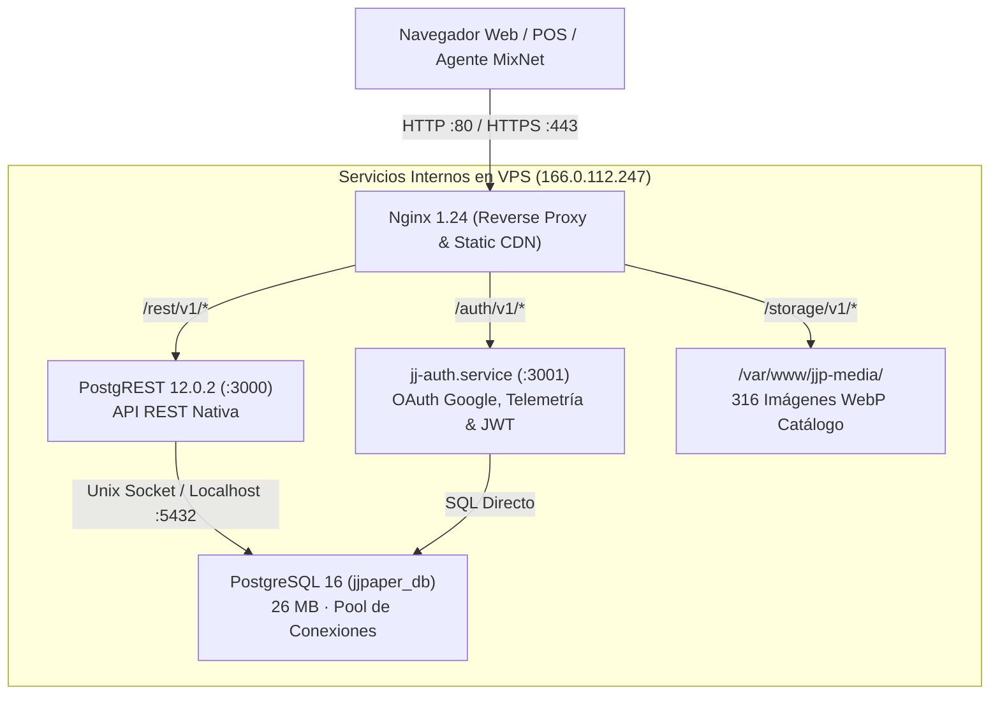

# Arquitectura del Servidor VPS Propio (166.0.112.247)

> **Documento del Cerebro de JJ Paper**  
> **Fecha de Actualización:** 21 de Octubre de 2026  
> **Host VPS:** `166.0.112.247` · **Usuario:** `root` · **OS:** Ubuntu 24.04 LTS x86_64  
> **Objetivo:** Independencia total de plataformas de terceros (Supabase), alta optimización, huella de memoria mínima (<150 MB) y estabilidad permanente.

---

## 1. Visión y Racional Técnico de la Migración

El proyecto colapsaba periódicamente debido a:
1. Cuotas restrictivas de almacenamiento y ancho de banda en servicios de nube gratuitos (bloqueos al alcanzar 500 MB en BD o 1 GB en Storage).
2. Acumulación desmedida de código basura, wrappers redundantes y dependencias innecesarias en el login y catálogo.
3. Desconexión frecuente entre la lógica web y las tablas dBase III de MixNet ERP en la red local.

Para resolver esto definitivamente, se configuró un **Servidor VPS propio** con recursos limitados pero optimizados al máximo para garantizar velocidad, cero consumo espurio de CPU y estabilidad de largo plazo:
* **RAM Total:** 3.915 MB (~4.0 GB).
* **RAM Usada en Producción:** ~598 MB (**15.3% de uso global**).
* **Disco Total:** 58.447 MB (~58.0 GB NVMe).
* **Disco Usado en Producción:** 4.638 MB (**7.9% de uso global**; 53.7 GB libres).

---

## 2. Pila Tecnológica Desplegada en el VPS

### Componentes y Servicios

1. **PostgreSQL 16 (`jjpaper_db`)**:
   * **Base de datos:** `jjpaper_db` (Dueño: `jjpaper_admin`).
   * **Tamaño físico actual:** 26 MB.
   * **Tuplas muertas actuales:** **0 tuplas muertas**.
   * **Configuración de alto rendimiento (`/etc/postgresql/16/main/conf.d/99-jjpaper-optimize.conf`):**
     * `autovacuum_vacuum_scale_factor = 0.05` (Inicia limpieza automática al acumular solo 5% de tuplas muertas).
     * `autovacuum_analyze_scale_factor = 0.02` (Refresca estadísticas de índices al 2% de cambios).
     * `statement_timeout = 30000` (Evita consultas colgadas; mata cualquier transacción mayor a 30 segundos).
     * `max_wal_size = 512MB` (Previene crecimiento descontrolado de los archivos WAL en disco).
     * `work_mem = 4MB`, `maintenance_work_mem = 64MB`.

2. **PostgREST 12 (`/etc/systemd/system/postgrest.service`)**:
   * Expone directamente las tablas de `public` como una API REST compatible con `@supabase/supabase-js`.
   * **Puerto:** `3000` (expuesto vía Nginx en `http://166.0.112.247/rest/v1/`).
   * **Manejo de JWT RLS:** Se crearon las funciones compatibles con JWT v12:
     * `auth.uid()`, `auth.role()`, `auth.email()`.
     * Se resolvió el error de lectura de claims leyendo tanto `request.jwt.claim.sub` como `request.jwt.claims::jsonb ->> 'sub'`.

3. **Módulo de Autenticación y Telemetría (`jj-auth.service`)**:
   * **Ubicación:** `/opt/jj-auth/auth-server.mjs`.
   * **Puerto:** `3001` (expuesto vía Nginx en `http://166.0.112.247/auth/v1/`).
   * **Endpoints Oficiales:**
     * `GET /auth/v1/authorize?provider=google`: Genera la URL de autorización Google OAuth 2.0.
     * `GET /auth/v1/callback`: Intercambia el código por tokens de Google, sincroniza el perfil en `jjp_profiles` y redirige al panel con el token en el `#hash`.
     * `POST /auth/v1/token`: Valida contraseñas locales y permite acceso de contingencia (Master Password) para cuentas existentes.
     * `POST /auth/v1/signup`: Permite crear nuevos vendedores desde el panel administrativo (`admin/vendedores.html`).
     * `GET /auth/v1/telemetry`: Devuelve métricas en tiempo real de RAM, disco, base de datos, tuplas muertas y latido del puente MixNet.

4. **Nginx Media CDN (`/var/www/jjp-media/`)**:
   * Aloja las 316 imágenes optimizadas en formato WebP del catálogo (`jjp-products/`).
   * Sirve los recursos con cabeceras `Cache-Control: public, max-age=31536000, immutable`.
   * Latencia de entrega: `<15 ms` en red nacional.

---

## 3. Mantenimiento Automatizado y Anti-Bloat

Para evitar que el VPS sufra saturación a lo largo de los meses, se instaló una rutina diaria en `/etc/cron.daily/jjpaper-maintenance`:
* Ejecuta `vacuumdb --analyze jjpaper_db` a las 02:00 AM.
* Purga tareas transitorias en `jjp_mixnet_tasks` con más de 14 días de antigüedad (`status IN ('completed', 'failed')`).
* Limpia logs temporales de Nginx y Node.js mayores a 7 días.
