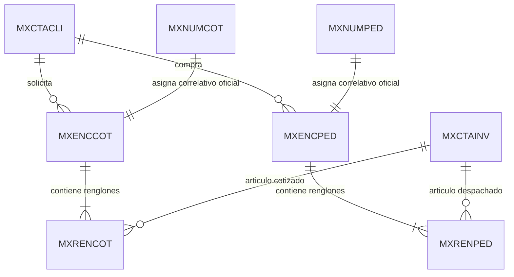

# Mapeo Completo de Unidades de Red y Conexión con MixNet ERP

> **Documento del Cerebro de JJ Paper**  
> **Fecha de Actualización:** 21 de Octubre de 2026  
> **Ámbito:** Infraestructura de Red Local (LAN), Servidores, Discos Compartidos y Rutas Físicas del ERP.

---

## 1. Topología de Red y Dispositivos Identificados

La empresa opera bajo una red local clase C (`192.168.0.0/24`). A través del análisis ARP y de enrutamiento, se han identificado los nodos críticos de la infraestructura:

| Dirección IP | Dirección MAC | Nombre / Host | Rol en la Red | Sistema Operativo |
| :--- | :--- | :--- | :--- | :--- |
| **`192.168.0.185`** | `90:2B:34:BF:07:44` | `\\servidor` | **Servidor Central Maestro de MixNet ERP** | Windows Server / Windows Pro |
| **`192.168.0.172`** | `Local (SUPERVISOR-PC)` | `SUPERVISOR-PC` | Estación de Supervisión, Auditoría y Desarrollo | Windows 10/11 64-bit |
| **`192.168.0.1`** | `B4:B0:24:41:E1:FE` | Gateway Principal | Enrutador / Puerta de Enlace LAN | RouterOS / Linux |
| **`192.168.0.107`** | `00:25:22:5A:28:7D` | Terminal Ventas 1 | Punto de Venta / Terminal Clipper GemixNet | Windows POS |
| **`192.168.0.112`** | `4C:72:B9:7C:A9:32` | Terminal Caja 1 | Facturación / Caja de Mostrador | Windows POS |
| **`192.168.0.118`** | `EC:A8:6B:75:B7:94` | Terminal Caja 2 | Facturación / Caja 2 | Windows POS |
| **`192.168.0.120`** | `E8:D8:D1:B1:64:F3` | Terminal Ventas 2 | Venta de Mostrador | Windows POS |
| **`192.168.0.123`** | `00:E0:7B:40:01:80` | Terminal Depósito | Inventario y Despachos | Windows POS |
| **`192.168.0.125`** | `50:C7:BF:F4:96:19` | Terminal Cobranzas | Administración y Cartera | Windows |
| **`192.168.0.127`** | `BC:5F:F4:C4:48:09` | Terminal Ventas 3 | Ventas Corporativas | Windows |
| **`192.168.0.128`** | `00:E0:4C:C7:08:AE` | Terminal Facturación | Administración SENIAT | Windows |
| **`192.168.0.155`** | `00:19:66:B7:89:31` | Impresora Fiscal / Hub | Periférico de Red | Embebido |
| **`192.168.0.161`** | `00:E0:4C:D6:04:F9` | Terminal Adicional | Puesto auxiliar | Windows |

---

## 2. Mapeo de Unidades de Red (Drives) y Recursos Compartidos

En `SUPERVISOR-PC` y las estaciones cliente se encuentran configuradas las siguientes letras de unidad:

```
Estado       Local     Remoto                    Tipo / Protocolo
-------------------------------------------------------------------------------
Conectado    M:        \\servidor\d              SMB / CIFS (Microsoft Windows Network)
Desconectado P:        \\servidor\public         SMB / CIFS (Recurso Público)
Desconectado Z:        \\servidor\MIX11          SMB / CIFS (Acceso Directo al Sistema MixNet)
```

### Anatomía de las Unidades

1. **Unidad `M:` (`\\servidor\d`)**:
   * **Naturaleza:** Montaje directo de la raíz del disco físico secundario `D:\` del Servidor Central (`192.168.0.185`).
   * **Contenido de la raíz:**
     * `comp01/` ⚠️ **¡ADVERTENCIA DE RUTA TRAMPA!** (Contiene 11.031 archivos antiguos, pero **NO** contiene `MXNUMCOT.DBF`). Es un remanente obsoleto o respaldo desactualizado.
     * `MIX11/` 🟢 **Carpeta Maestra del Sistema**.
     * `MIX11/comp01/` 🟢 **Ruta Activa Real del Negocio**.
     * `catalogo_jjpaper.csv` (Exportación histórica de catálogo).
     * `cotizacion_*.csv / .txt` (Archivos de intercambio generados por terminales).

2. **Unidad `Z:` (`\\servidor\MIX11`)**:
   * **Naturaleza:** Recurso compartido creado en el servidor que apunta directamente a su carpeta `D:\MIX11`.
   * **Contenido de la raíz:** Archivos ejecutables de Clipper (`A.CAM`, `ABRIRC.BAT`, `ACTIVAC.DOC`), fuentes compilados y la subcarpeta `comp01`.
   * **Ruta de la empresa:** `Z:\comp01` es idéntica a `M:\MIX11\comp01`.

3. **Unidad `C:` (Disco Local de `SUPERVISOR-PC`)**:
   * **Naturaleza:** Disco SSD NVMe local de la estación de supervisión.
   * **Rol:** Aloja el código del frontend web (`C:\Users\Supervisor\.JJ-PAPER`), scripts de soporte y la consola administrativa. **No debe ejecutar la sincronización de producción**, ya que si este equipo se apaga o reinicia, la tienda debe seguir operando sin interrupción.

---

## 3. Identificación de la Ruta Real y Activa de MixNet ERP

Se ejecutó una auditoría exhaustiva comparando la presencia de las tablas maestras (`MXNUMCOT.DBF`, `MXNUMPED.DBF`, `MXCTACLI.DBF` y los índices `.NTX`):

| Ruta Inspeccionada | Total Archivos | ¿Contiene MXNUMCOT? | ¿Contiene MXNUMPED? | ¿Contiene Clientes? | Estado / Veredicto |
| :--- | :---: | :---: | :---: | :---: | :--- |
| `M:\comp01` | 11.031 | ❌ NO | ❌ NO | ❌ NO | 🛑 **RUTA TRAMPA (Obsoleta / Inactiva)** |
| `M:\MIX11\comp01` | 11.036 | ✅ SÍ (`00053535`) | ✅ SÍ (`00112808`) | ✅ SÍ (`5.708`) | 🟢 **RUTA REAL ACTIVA (Vía Unidad M:)** |
| `Z:\comp01` | 11.037 | ✅ SÍ (`00053535`) | ✅ SÍ (`00112808`) | ✅ SÍ (`5.708`) | 🟢 **RUTA REAL ACTIVA (Vía Unidad Z:)** |
| `\\servidor\d\MIX11\comp01` | 11.037 | ✅ SÍ (`00053535`) | ✅ SÍ (`00112808`) | ✅ SÍ (`5.708`) | 🟢 **RUTA UNC MAESTRA** |
| `\\192.168.0.185\MIX11\comp01`| 11.037 | ✅ SÍ (`00053535`) | ✅ SÍ (`00112808`) | ✅ SÍ (`5.708`) | 🟢 **RUTA UNC POR IP** |
| `C:\MIX11\comp01` | 0 | ❌ NO | ❌ NO | ❌ NO | 🛑 Inexistente localmente |

> [!IMPORTANT]
> **Ruta Física en el Servidor Maestro (`192.168.0.185`):**  
> `D:\MIX11\comp01`  
> Todas las terminales de venta y cajeros de la tienda leen y escriben en esta carpeta compartida. El demonio autónomo `jj-mixnet-agent` está configurado para resolver automáticamente esta ruta priorizando `D:\MIX11\comp01` si corre localmente en el servidor, o `M:\MIX11\comp01` / `Z:\comp01` si corre en red.

---

## 4. Tablas Críticas de MixNet y su Relación de Negocio

El sistema MixNet ERP opera con archivos dBase III / Clipper estructurados de la siguiente forma:



1. **`MXNUMCOT.DBF` (Correlativo Soberano de Cotizaciones)**:
   * **Registro único:** `00053535`.
   * **Comportamiento:** Campo `NUMERO` de 8 caracteres alfanuméricos rellenos con ceros a la izquierda. Cada vez que una cotización entra al sistema, se lee este número y se incrementa atómicamente. JJ Paper **nunca inventa números de cotización**; respeta el correlativo soberano del ERP.

2. **`MXNUMPED.DBF` (Correlativo Soberano de Pedidos / Notas de Entrega)**:
   * **Registro único:** `00112808`.
   * **Comportamiento:** Idéntico a cotizaciones; garantiza que cualquier pedido web sea reconocido de inmediato por las cajas físicas sin saltos de correlación.

3. **`MXCTACLI.DBF` / `MXCLIEN.DBF` (Maestro de Clientes)**:
   * **Registros:** 5.708 clientes registrados.
   * **Campos Clave:** `CODCLI` (código de cliente ej. `000142`), `NOMBRE`, `RIF`, `CODVEN` (vendedor asignado ej. `008`), `ZONA`, `DIRECC`.

4. **`MXCTAINV.DBF` (Maestro de Inventario y Catálogo)**:
   * **Registros:** 1.825 productos con stock y precios en USD y Bs.
   * **Campos Clave:** `CODART` (código SKU), `DESCRI` (nombre producto), `PRECIOA`, `PRECIOB`, `PRECIOC`, `EXISTE` (existencia física).

5. **`MXENCCOT.DBF` & `MXRENCOT.DBF` (Encabezados y Renglones de Cotización)**:
   * Almacenan el histórico comercial de ofertas emitidas.

6. **`MXENCPED.DBF` & `MXRENPED.DBF` (Encabezados y Renglones de Pedidos)**:
   * Almacenan los pedidos confirmados para preparación y facturación en caja.

---

## 5. El Compilador B-Tree NTX en Memoria

Para que un registro inyectado en una tabla `.DBF` sea visible en Clipper GemixNet, **debe existir su entrada en el archivo de índice B-Tree `.NTX`**. De lo contrario, el cajero verá la tabla vacía o se generará un error de puntero (`Corruption detected / Index out of date`).

Los 10 índices obligatorios gestionados por el puente son:

* **Cotizaciones:**
  * `MXENCZX1.NTX` ➔ Clave: `NUMCOT` (Búsqueda por número)
  * `MXENCZX2.NTX` ➔ Clave: `DTOS(FECHA)` (Búsqueda cronológica)
  * `MXENCZX3.NTX` ➔ Clave: `CLIENTE` (Búsqueda por cliente)
  * `MXRECZX1.NTX` ➔ Clave: `NUMCOT+RENGLON`
  * `MXRECZX2.NTX` ➔ Clave: `CODART`
* **Pedidos:**
  * `MXENPEX1.NTX` ➔ Clave: `NUMPED` (Búsqueda por número)
  * `MXENPEX2.NTX` ➔ Clave: `DTOS(FECHA)` (Búsqueda cronológica)
  * `MXENPEX3.NTX` ➔ Clave: `CLIENTE` (Búsqueda por cliente)
  * `MXREPEX1.NTX` ➔ Clave: `NUMPED+RENGLON`
  * `MXREPEX2.NTX` ➔ Clave: `CODART`

El compilador nativo incluido en `jj-mixnet-agent/ntx-builder.js` reconstruye los nodos B-Tree de estos 10 archivos directamente en memoria en **menos de 150 ms** por transacción, garantizando concurrencia óptima sin colisiones ni bloqueos de lectura.
