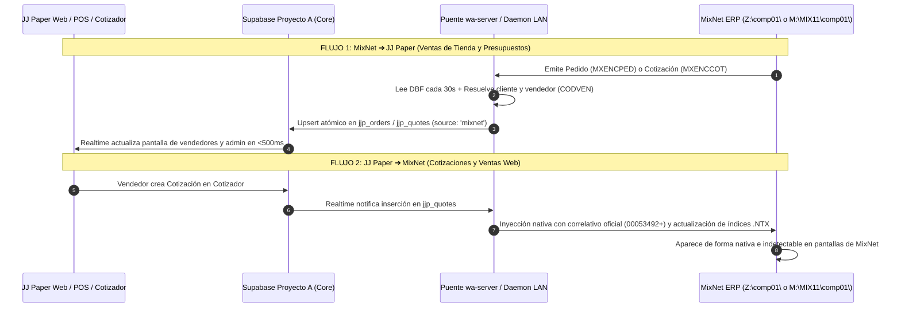

# 🏛️ Guía Maestra de Arquitectura MixNet ERP, Mapeo de Red LAN y Sincronización Bidireccional

> **JJ PAPER C.A. — Documento Técnico Definitivo de Integración ERP**  
> *Fecha de consolidación: Octubre 2026*  
> *Entorno: PC Supervisor (`192.168.0.172`), Servidor MixNet (`192.168.0.185`), Supabase Multi-Proyecto (A Core, B Comm, C Storage)*

---

## 1. 🗺️ Topología de Red y Mapeo de Unidades

Tras el análisis exhaustivo en caliente del entorno de red de la empresa, se determinó el mapa real de almacenamiento y compartición:

| Unidad | Ruta UNC / IP | Función / Contenido | Estado Actual |
| :---: | :--- | :--- | :--- |
| **`Z:`** | `\\servidor\MIX11` (o `\\192.168.0.185\MIX11`) | **Raíz viva del ejecutable MixNet y subcarpeta `comp01` con la base de datos real.** | 🟢 **ACTIVA / PRIMARIA** (`MXNUMPED`: `00112771`, `MXNUMCOT`: `00053492`). |
| **`M:`** | `\\servidor\d` (o `\\192.168.0.185\comp01`) | Contiene `M:\MIX11\comp01\` (espejo directo de `Z:\comp01\`) y `M:\comp01` (copia previa). | 🟢 **CONECTADA** — Apuntar siempre a `M:\MIX11\comp01\` o `Z:\comp01\`. |
| **`P:`** | `\\servidor\pedidos` / `Elias` | Unidad auxiliar con históricos de 2022 (`P:\Elias\MIX\MIX11\comp01`). | ⚠️ **HISTÓRICO / NO USAR** (para evitar sobreescribir datos vivos con versiones viejas). |
| **`C:`** | Local (`C:\Users\Supervisor\.JJ-PAPER`) | Repositorio git, servidor `wa-server`, carpetas de intercambio local (`C:\JJ-PAPER-MIXER`). | 🟢 **OPERATIVA** (PC Supervisor). |

---

## 2. 🗄️ Diccionario de Tablas Maestras `.DBF` e Índices `.NTX`

MixNet opera sobre un motor **xBase / Clipper 5.x / Harbour** con tablas dBase III (`0x03`, sin campos memo) e índices B-Tree compilados **`.NTX`**:

```
Z:\comp01\ (o M:\MIX11\comp01\)
├── MXNUMCOT.DBF    [Control correlativo cotizaciones] (1 registro, campo NUMERO C 8)
├── MXNUMPED.DBF    [Control correlativo pedidos]       (1 registro, campo NUMERO C 8)
├── MXENCCOT.DBF    [Cabecera de cotizaciones]         Índice: MXRECZX1.NTX (NUMCOT)
├── MXRENCOT.DBF    [Renglones de cotizaciones]        Índice: MXRENCOT.NTX (NUMCOT + ITEM)
├── MXENCPED.DBF    [Cabecera de pedidos]              Índice: MXENPEX1.NTX (NUMPED), MXENPEX2.NTX (CLIENTE)
├── MXRENPED.DBF    [Renglones de pedidos]             Índice: MXRENPED.NTX (NUMPED + ITEM)
├── MXENCFAC.DBF    [Facturas fiscales SENIAT]         Índice: MXENFAC1.NTX (NUMFAC)
├── MXRENFAC.DBF    [Renglones de facturas fiscales]   Índice: MXREFAC1.NTX (NUMFAC + ITEM)
├── MXCTACLI.DBF    [Maestro de clientes]              Índice: MXCTACLI.NTX (CODCLI), MXCTAC2.NTX (NOMCLI), MXCTAC3.NTX (CIF)
├── MXCTAINV.DBF    [Catálogo maestro de inventario]   Índice: MXCTAIN1.NTX (ITEM), MXCTAIN2.NTX (DESCRIP)
└── VICTAINV.DBF    [Stock físico en tiempo real]      Índice: VICTAIN1.NTX (ITEM)
```

---

## 3. 📋 Estructura Exacta de Campos Críticos

### A. Cabeceras (`MXENCPED.DBF` y `MXENCCOT.DBF`)
- **`NUMPED` / `NUMCOT`** (`Character, 8`): Correlativo numérico estricto de 8 dígitos relleno con ceros a la izquierda (ej: `00112771`, `00053492`). Prohibido prefijos alfanuméricos (`PED-`, `MIX-`, `COT-`).
- **`EMISION`** (`Date, 8`): Fecha de emisión en formato `YYYYMMDD`.
- **`CLIENTE`** (`Character, 8`): Código del cliente en `MXCTACLI` (ej: `001-028`). Clientes no registrados en caja usan `00` (`CUENTA RECUPERADA`).
- **`CODVEN`** (`Character, 5`): Código de vendedor de nómina (ver sección 4).
- **`COMEN1` / `COMEN2`** (`Character, 35`): Notas reales de entrega/despacho (ej: `RETIRA EN TIENDA`). Si no hay notas, **debe dejarse vacío (espacios en blanco `0x20`)**. Prohibido inyectar `[MixNet Caja]` o números de sistema web.
- **`TOT_PED` / `TOT_COT`** (`Numeric, 14.2`): Total en USD.
- **`ESTATUS`** (`Character, 2`): `PE` = Pendiente, `FA` = Facturado, `AN` = Anulado.
- **`MONEDA`** (`Character, 3`): `US$` o `BS `.
- **`CAMBIO`** (`Numeric, 12.4`): Tasa oficial de cambio BCV.

### B. Renglones (`MXRENPED.DBF` y `MXRENCOT.DBF`)
- **`NUMPED` / `NUMCOT`** (`Character, 8`): Enlace con la cabecera correspondiente.
- **`ITEM`** (`Character, 15`): SKU del producto (ej: `LI-PAFOC`).
- **`DESCRIP`** (`Character, 50`): Descripción del ítem.
- **`UNIDAD`** (`Character, 3`): Unidad de despacho (`UND`, `PQT`, `RES`, `CJA`).
- **`CANTIDAD`** (`Numeric, 14.3`): Cantidad física vendida con 3 decimales.
- **`PRECIO`** (`Numeric, 17.2`): Precio unitario en USD.
- **`TOT_REN`** (`Numeric, 19.2`): Subtotal (`CANTIDAD * PRECIO`).
- **`IVA`** (`Character, 1`): `A` = Alícuota General (16%), `E` = Exento.
- **`CLIENTE`** (`Character, 8`) y **`CODVEN`** (`Character, 5`): Idénticos a la cabecera.

---

## 4. 👥 Nómina Sagrada de Vendedores (`CODVEN`)

MixNet totaliza las comisiones agrupando por `CODVEN`. Cualquier alteración afecta la nómina del personal:

| `CODVEN` | Asesor / Vendedor | Zona / Ámbito | Regla de Sincronización |
| :---: | :--- | :--- | :--- |
| **`002`** | **Luis Alarcón** | Calle / Mayor | Prioridad absoluta al documento. |
| **`004` / `006`** | **Yovanni Araujo** | Institucional / Mayor | Asignado a Yovanni en JJ Paper. |
| **`008`** | **Marianela** | Cartera asignada | Asignado a Marianela en JJ Paper. |
| **`014`** | **Andreina** | Cartera asignada | Asignado a Andreina en JJ Paper. |
| **`010`** | **Keyder Salazar (Admin)** | Cartera Zona 010 (191 clientes) | Cartera exclusiva de Keyder. |
| **`020`** | **Keyder Salazar (Admin)** | Cartera MixNet Zona 020 (3.474 clientes) | Cartera administrativa de Keyder. |
| **`005`** | **Mostrador / Tienda Física** | Mostrador caja física | **NO atribuir a Keyder ni a vendedores de calle.** |
| **`001`** | **Mary García** | Asesor comercial | Asignado a Mary García. |
| **`025`** | **Ana Barajas** | Asesor comercial | Asignado a Ana Barajas. |

---

## 5. 🛑 El Peligro de los Índices `.NTX` y Concurrencia Clipper

### Causa Raíz de Bloqueos y Pantallas Congeladas
1. **Desalineación B-Tree**: Escribir directamente bytes al final de un archivo `.DBF` mediante Node.js o Python sin abrir y actualizar los archivos `.NTX` corrompe los árboles B-Tree. Clipper asume que el índice refleja todos los registros; al iterar un índice desactualizado, entra en bucles infinitos en pantalla y multiplica registros en los browses.
2. **Colisiones de Bloqueo (`Lock Contention`)**: Clipper bloquea registros usando `RLOCK()` y la tabla con `FLOCK()` mediante rangos de bytes de Windows SMB. Si un proceso externo escribe en el archivo mientras un cajero factura en la terminal, la tabla se corrompe.

### Solución Definitiva de Escritura
Para escribir de JJ Paper a MixNet de forma 100% nativa e indetectable, se debe emplear un micro-conector compilado en **Harbour con RDD `DBFNTX`**:

```clipper
// Código nativo Harbour para inserción segura y atómica
FUNCTION InsertarCotizacionMixNet(cDir, cNumCot, dFecha, cCodCli, cCodVen, cNota, nTotal, aItems)
   LOCAL nI

   USE (cDir + "MXENCCOT") INDEX (cDir + "MXRECZX1") SHARED
   IF NETERR()
      RETURN .F.
   ENDIF

   APPEND BLANK
   IF !NETERR()
      REPLACE NUMCOT   WITH cNumCot
      REPLACE EMISION  WITH dFecha
      REPLACE CLIENTE  WITH cCodCli
      REPLACE CODVEN   WITH cCodVen
      REPLACE COMEN1   WITH PADR(cNota, 35)
      REPLACE COMEN2   WITH SPACE(35)
      REPLACE TOT_COT  WITH nTotal
      REPLACE ESTATUS  WITH "PE"
      REPLACE MONEDA   WITH "US$"
      UNLOCK
   ENDIF
   CLOSE MXENCCOT

   USE (cDir + "MXRENCOT") INDEX (cDir + "MXRENCOT") SHARED
   FOR nI := 1 TO LEN(aItems)
      APPEND BLANK
      IF !NETERR()
         REPLACE NUMCOT   WITH cNumCot
         REPLACE ITEM     WITH aItems[nI, 1]
         REPLACE DESCRIP  WITH aItems[nI, 2]
         REPLACE CANTIDAD WITH aItems[nI, 3]
         REPLACE PRECIO   WITH aItems[nI, 4]
         REPLACE TOT_REN  WITH aItems[nI, 3] * aItems[nI, 4]
         REPLACE UNIDAD   WITH aItems[nI, 5]
         REPLACE IVA      WITH aItems[nI, 6]
         REPLACE CLIENTE  WITH cCodCli
         REPLACE CODVEN   WITH cCodVen
         REPLACE EMISION  WITH dFecha
         REPLACE ESTATUS  WITH "PE"
         UNLOCK
      ENDIF
   NEXT
   CLOSE MXRENCOT

   // Actualizar correlativo de control oficial
   USE (cDir + "MXNUMCOT") SHARED
   IF !NETERR()
      REPLACE NUMERO WITH STRZERO(VAL(cNumCot) + 1, 8)
      UNLOCK
   ENDIF
   CLOSE MXNUMCOT

   RETURN .T.
```

---

## 6. 🔄 Flujo de Sincronización Bidireccional Automática

El usuario solicitó expresamente: **Eliminar botones manuales postizos ("Agregar a MixNet")**. El sistema debe operar en sincronía transparente:



---

## 7. 🚀 Dónde debe vivir el puente: Recomendación de Despliegue

El usuario preguntó si el puente debe vivir en esta PC o en la red:

1. **Opción Actual (PC Supervisor `192.168.0.172`)**:
   - Corre desacoplado mediante `wscript.exe start-hidden.vbs` bajo el Session Manager de Windows.
   - Tiene acceso directo a la unidad de red mapeada `Z:\comp01` y `M:\MIX11\comp01`.
   - **Ventaja**: Ya está configurado con Node.js, WhatsApp Baileys, Gmail OAuth y conexión LAN.
2. **Opción Recomendada (Servidor de Red `192.168.0.185`)**:
   - Si se instala un script agentico ligero (ej. demonio compilado en Go o microservicio Harbour) directamente en la máquina `192.168.0.185` (donde residen físicamente los discos de MixNet):
     - **Cero latencia de red SMB**: Las lecturas y escrituras en `.DBF` e índices `.NTX` son locales (disco duro directo), eliminando retrasos y bloqueos de red Windows.
     - **Independencia absoluta de las PCs de escritorio**: Si la PC Supervisor se apaga, se reinicia o entra en suspensión, el puente y las cotizaciones siguen sincronizándose 24/7.
